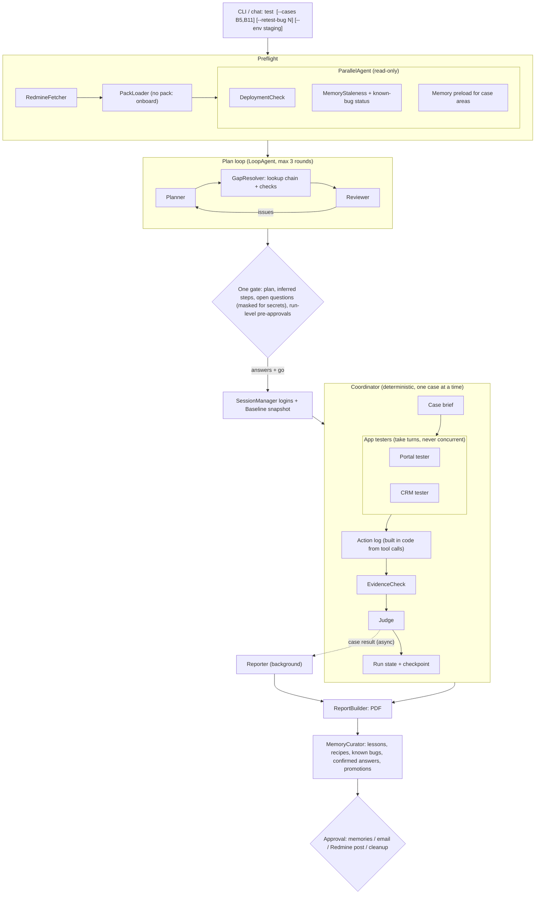

# Redmine Test Agent: Architecture and Technical Spec

Status: design only, nothing built. Rebuilt 6 Oct 2026 after the original folder was lost; includes every change agreed up to 6 Oct (multi-project, RDP v1.1 review, multi-agent roles, judge action log, page-text snapshots, no local fallback model, gap resolution).
Companions: `test-agent-rdp.md` (requirements), `core-testing-spec.md` (shared workflow, case types, result labels, bug format, guardrails, general lessons) and `packs/<project>/facts.md` (per-project addresses, roles, rules, UI recipes, known bugs). Savostore (`packs/savostore/`) is the first pack. Those files say *what* to test; this file says *how* the agent runs. Nothing project-specific lives in the engine or prompts.

---

## 1. Goals and principles

- Take a Redmine task ID from any onboarded project and run its test cases on that project's staging (or approved prod), end to end, producing a PDF report with evidence, for any kind of test case.
- **Works across projects.** One engine, one project pack per project (section 15). Lessons go to the project's pack and move to the shared core only once proven general.
- **Finds its own gaps, then asks.** Missing URLs, logins, roles or data are looked up in a fixed order, checked against what the cases need, and anything still missing is asked in one batch before testing (section 16).
- **Agentic where judgment is needed, deterministic everywhere else.** The model plans, infers missing steps, handles unfamiliar UI and decides verdicts. Fixed code fetches, logs in, reads values, does math, keeps state, builds reports and enforces approvals.
- **Learns over time.** Corrections and proven workarounds become memory; stable workarounds become fixed helpers.
- **Safe by default.** Staging only, approval before anything that changes data or costs money, never posts or emails without asking.
- **Every number comes from the page.** The model never invents figures or does mental math.

## 2. Stack

| Piece | Choice | Notes |
|---|---|---|
| Language | Python 3.12 | Already on the laptop (Ubuntu 24.04) |
| Agent framework | Google ADK (`google-adk`) | Workflow agents (`SequentialAgent`, `LoopAgent`, `ParallelAgent`), custom agents, session and memory services, `adk web` debug UI |
| LLM | `ai.rolustech.com/v1` (vLLM, Gemma 4 31B AWQ, model id `gemma4`, 65K context) | `LiteLlm(model="openai/gemma4", api_base=...)`. Native `tool_calls` confirmed 1 Oct 2026, about 0.6 s per call |
| Local fallback LLM | None (user chose not to install `qwen3:4b`) | If the endpoint stays down after retries, the run pauses at its checkpoint and resumes later |
| Browser | Playwright MCP (`@playwright/mcp`, Node via `npx`) over stdio, through ADK `McpToolset` | One instance per app in the pack (Savostore: portal and CRM), each with its own browser profile |
| Python Playwright | `playwright` (pip) | PDF rendering and fixed helpers. Shares `~/.cache/ms-playwright`; Chromium is installed only if the right build is missing |
| Redmine | Python REST client (`requests`) | Deterministic. Also reads wiki pages for gap lookup |
| Memory store | SQLite + `sqlite-vec`, embeddings from Ollama `nomic-embed-text` (installed locally 1 Oct 2026) | The Rolustech endpoint has no embedding model |
| Sessions / resume | ADK `DatabaseSessionService` (SQLite) | Resume at the first unfinished case |
| Secrets | `.env` plus masked terminal input (`getpass`), optionally the OS keyring | Memory stores where a secret lives, never its value |
| Report | Jinja2 HTML, rendered to PDF with Playwright `page.pdf()` | |
| Email (optional) | Gmail SMTP app password, user's own inbox only | Only after approval |

**Laptop limits** (1 Oct 2026): i7-1355U, 15 GB RAM with about 4 GB free, Iris Xe (no CUDA), disk 96% full with about 20 GB free. Hence a remote LLM and strict artifact retention (section 10).

## 3. Architecture (multi-agent, split by role)

Agents are split by **role, not by test case**. Cases share wallets, orders and logged-in sessions, so they always run **one at a time**. Only read-only work runs in parallel. The coordinator is fixed code, so case order and approvals can't drift.



Logins and the baseline run **after** the gate, because they may depend on answers to open questions (URLs, accounts).

### 3.1 Agent inventory

| Component | ADK type | Model? | Job |
|---|---|---|---|
| `Orchestrator` | `SequentialAgent` | No | Preflight, plan loop, gate, setup, coordinator, report, curator, final gate |
| `RedmineFetcher` | Custom `BaseAgent` | No | Issue + test-case child task (pattern/project from the pack) + journals + attachments |
| `PackLoader` | Custom `BaseAgent` | No | Maps the Redmine project to a pack; loads `pack.yaml`, `facts.md`, helpers, allowlist, scoped memories. No match: stop and offer `onboard` |
| `PreflightParallel` | `ParallelAgent` | Mostly no | `DeploymentCheck`, `MemoryStaleness`, memory preload side by side |
| `DeploymentCheck` | Custom | Rules; model only for ambiguous comments | Is the feature on the target env? If not, stop and report |
| `MemoryStaleness` | Custom | No | Linked bug statuses; flags lessons and saved answers for re-check |
| `Planner` | `LlmAgent`, `output_schema=TestPlan` | Yes | Case types, preconditions, inferred steps, irreversible-last ordering, list of required resources |
| `GapResolver` | Custom + small model calls | Partly | Resolves every required resource through the lookup chain, checks it, and turns the rest into questions (section 16) |
| `Reviewer` | `LlmAgent` | Yes | Checks plan and resolved resources against facts, lessons and live values; approves or returns issues (`exit_loop`) |
| `SessionManager` | Custom | No | Logs in with the confirmed accounts, keeps sessions alive, never logs out |
| `Baseline` | Custom | No | Reads the pack's baseline fields (Savostore: wallet Current/Total/Used, thresholds, rates) |
| `Coordinator` | Custom `BaseAgent` (loop) | No | Holds plan and run state, hands out one case at a time, routes steps to the right tester, enforces limits and approvals, builds the action log |
| `PortalTester` / `CRMTester` (one per app in the pack) | `LlmAgent` + that app's Playwright MCP + pack helpers | Yes | Drives only its app. Returns values, screenshots, page-text snapshots. Raw snapshots stay in its own context |
| `EvidenceCheck` | Custom + small model call | Partly | Screenshot exists, name matches, image shows the claim |
| `Judge` | `LlmAgent`, `output_schema=CaseResult` | Yes | Verdict from the case brief, the code-built action log, evidence and memory. Never sees tester reasoning. Matches known bugs |
| `Reporter` | `LlmAgent`, background task | Yes | Notes and bug drafts per finished case while the next runs. Figures only from run state |
| `ReportBuilder` | Custom | No | HTML to PDF, summary, baseline vs final, leftovers |
| `MemoryCurator` | `LlmAgent` | Yes | End of run: proposes lessons, recipes, open bugs, confirmed answers and core promotions, for approval |

### 3.2 Hand-offs and context
- The coordinator gives each tester a **case brief**: its steps, needed values, relevant lessons. Not the whole run history.
- Testers return a fixed `StepResult` (values, screenshot paths, snapshot paths, notes, `stuck` flag).
- Cross-system cases alternate testers step by step (e.g. CRM adds a parcel, portal checks shipping). One browser acts at a time.
- The judge gets the brief, expected result, recorded values, evidence, memory, and the **action log**: steps actually run, in order, with `inferred` flags, approval records, outcomes and any deviation from the plan. The coordinator builds the log in code from tool calls, not from the tester's words. If a required step is missing, the judge must return AGENT INCOMPLETE, not FAIL.
- A tester reporting `stuck`, or hitting its limit twice, makes the case AGENT INCOMPLETE.
- A gap discovered mid-run (rare, since gaps are resolved during planning) pauses that case with one question; other independent cases may continue.

### 3.3 Concurrency
- All agents share `ai.rolustech.com`. Parallel work is capped by `LLM_MAX_CONCURRENCY` (default 2) until rate limits are known.
- Testers never run concurrently, whatever the setting.

## 4. Agentic vs deterministic split

| Deterministic (code) | Agentic (model) |
|---|---|
| Redmine fetch, wiki reads, posting (after approval) | Turning loose cases and comments into a plan |
| Gap lookup order, URL reachability and login checks, role checks against known markers | Deciding which resources a case needs; reading a wiki page or comment for a URL or account |
| Login, session keep-alive | Spotting conflicts (case says $200, config says $150) |
| Reading known fields | Inferring missing steps and preconditions |
| All math (`calculate`) | Choosing which earlier order or data to reuse |
| Screenshot naming, run state, action log, checkpoints | Navigating new or misbehaving UI |
| PDF, email, leftover list | Verdicts, including "intended behavior" calls |
| Approval gates, allowlist, action policy, masked secret input | Notes, bug drafts |
| Memory staleness, retention, redaction | Proposing lessons, recipes, promotions |

**Graduation path:** free Playwright driving, then a saved recipe after two successes, then a fixed helper once stable.

## 5. Data models (Pydantic)

```python
class CaseType(str, Enum):
    UI = "ui"; CROSS_SYSTEM = "cross"; NUMERIC = "numeric"
    DATA_SETUP = "setup"; ADMIN_CONFIG = "admin"; NOT_UI = "not_ui"

class Step(BaseModel):
    text: str
    app: str                      # app key from the pack, or "redmine" / "none"
    changes_data: bool
    costs_money: bool
    irreversible: bool = False    # e.g. opening checkout commits rewards; paying closes the order
    action_type: str | None = None  # e.g. "pay_staging_test_card"; matched against run pre-approvals
    needs_approval: bool
    inferred: bool = False
    inferred_reason: str | None = None
    inferred_source: str | None = None   # "pack fact", "memory:lesson#12", "case B3 output"

class Requirement(BaseModel):     # a resource the plan needs (section 16)
    key: str                      # "env.staging.portal_url", "account.crm.admin", "data.order_with_balance"
    needed_by: list[str]          # case ids
    must_have: list[str]          # checks, e.g. "reachable", "login works", "has admin settings menu"
    value: str | None             # non-secret value, or the name of the env var for a secret
    source: str | None            # "pack", "memory#31", "redmine wiki: Staging_Cardentials", "issue comment #7", "user 2026-10-06"
    status: Literal["resolved", "unverified", "failed_check", "missing"]
    question: str | None          # set when it must be asked

class PlannedCase(BaseModel):
    id: str; title: str; type: CaseType
    preconditions: list[str]; depends_on: list[str]
    steps: list[Step]; expected: str
    evidence_required: list[str]; values_to_record: list[str]
    conflicts: list[str]; skip_reason: str | None

class TestPlan(BaseModel):
    task_id: int; env: Literal["staging", "prod"]
    cases: list[PlannedCase]
    requirements: list[Requirement]
    global_conflicts: list[str]; data_to_create: list[str]
    preapprovable_actions: list[str]

class CaseResult(BaseModel):
    case_id: str
    verdict: Literal["PASS","FAIL","PARTIAL","BLOCKED","NOT VERIFIED","SKIPPED","AGENT INCOMPLETE"]
    known_bug: int | None = None  # "still present: bug N"
    steps_done: list[str]; expected: str
    actual: str                   # numbers only from recorded values
    values: dict[str, float | str]
    evidence: list[str]
    note: str | None              # required for every non-pass
    lessons_applied: list[int]; bug_draft_ids: list[str]
```

Plan checks before the gate: no dependency cycles; every prod `changes_data` step needs approval; every `admin` case has a restore step; every non-UI case has a `skip_reason`; on each test record every `irreversible` step comes after all other steps using that record (otherwise a fresh record); every requirement is `resolved` or has a question.

## 6. Tools

### 6.1 Tester tools
| Tool | Type | Notes |
|---|---|---|
| Playwright MCP, one per app | `McpToolset` (stdio), filtered | navigate, snapshot, find, click, type, fill_form, select_option, press_key, wait_for, take_screenshot, handle_dialog, navigate_back. No `browser_evaluate`; no upload unless needed |
| `read_known_value(name)` | Python | Selectors from the pack. Returns value + screenshot path |
| `record_value(name, value, source)` | Python | Run state, with timestamp and evidence |
| `calculate(expr, inputs)` | Python | Safe arithmetic on recorded values only |
| `screenshot(case_id, what)` | Python | `<case>-<nn>-<what>.png`, plus a masked page-text snapshot `<case>-<nn>-<what>.txt` |
| `request_approval(action, reason, details)` | Python, blocks | Logged. Auto-approved (and logged) only if the step's `action_type` is pre-approved for this run |
| `recall_lessons(query, area)` | Python | Top-k lessons, recipes, known bugs with status |
| `propose_memory(kind, text, area, evidence)` | Python | Queued for end-of-run approval |
| `report_gap(key, why)` | Python | Mid-run only: pauses the case with one question |
| `mark_step(step_idx, status, note)` | Python | Feeds the action log |
| Helpers (6.2) | Python | Preferred over free browsing when one exists |

### 6.2 Helpers (per pack, grow over time)
In `packs/<project>/helpers/`, loaded only for that project; generic helpers (login form, table read) in `core/helpers/`. Savostore candidates: `crm_add_parcel`, `portal_apply_rewards`, `crm_move_order_status`, `crm_ship_parcel` (click-intercept workaround), `portal_create_order`, `read_wallet`. Each returns structured values plus screenshots and has a smoke test.

### 6.3 Action policy (code, not prompt)
- Domain allowlist from the pack plus confirmed answers: staging only unless `--env prod` approved for the run. A URL found in the wiki or comments is added to the allowlist only after the user confirms it at the gate.
- Core and pack risky-action patterns (pay, submit, confirm, save on admin settings, delete, checkout URLs) trigger `request_approval`. Opening Stripe with rewards applied always needs approval.
- **Run-level pre-approval**: at the gate the user can tick action types (e.g. pay staging orders with the test card, move orders to delivered), for that run only. Settings changes, Redmine posts, emails and prod writes can't be pre-approved.
- Admin cases record the original value, restore it and verify the restore.

## 7. Memory

### 7.1 Layers
| Layer | Where | Lifetime | Written by |
|---|---|---|---|
| Core rules + lessons | `core/core-testing-spec.md` + rows scoped `core` | Permanent | User, or approved promotion |
| Project facts | `packs/<project>/facts.md` | Permanent | User |
| Run state | ADK session + `runs/<project>/<run_id>/state.json` | One run | Harness |
| Long-term memory | `memory/memory.db`, rows scoped `core` or `project:<slug>` | Across runs | User corrections (immediately), confirmed gap answers, approved agent proposals |

### 7.2 Record
```
id, kind (fact | lesson | recipe | known_bug | open_bug_found | resource),
scope (core | project:<slug>), area, applies_when,
text, value_or_ref (for resource: URL/username, or env var name for secrets),
source (user_correction | user_answer | redmine_wiki:<page> | issue_comment:<id> | agent_proposal | run_end),
linked_issue, evidence, status (active | needs_recheck | retired),
created_at, last_confirmed_at, success_count, failure_count
```

### 7.3 When memory is written
1. User corrects a verdict: saved immediately as a `lesson`.
2. User answers a gap question, or confirms a found value at the gate: saved as a `resource` with its source once a check passes in the run (e.g. login succeeded).
3. A workaround works twice: proposed `recipe`, approved at end of run.
4. End of run: open bugs saved as `open_bug_found` with case IDs.

### 7.4 Retrieval
- Only `core` plus the current project's memories are ever loaded.
- Deterministic preload of `active` memories for the case areas (about 1.5K tokens cap); `recall_lessons` on demand.

### 7.5 Staleness
- Linked bug closed: `needs_recheck`; the agent re-verifies instead of excusing.
- Recipe fails twice: `needs_recheck`.
- A `resource` that fails its check (URL unreachable, login rejected, role missing): `needs_recheck`, and it comes back as a question.
- `retired` rows are kept for audit, never loaded.

## 8. Run features
- **Baseline snapshot** before the first case; report shows baseline vs final.
- **Test-data ledger** with final states, run-ID tags, leftover list and approved cleanup.
- **Modes**: full; `--cases`; `--retest-bug`; `--dry-run` (plan and questions only); `--env prod` read-only by default; `onboard`.
- **Deployment check** first.
- **Progress updates**: console per case, optional milestone email.
- **Evidence check** before each verdict.
- **Resume** from the first unfinished case.

## 9. Reliability, limits, security
- **Limits**: 40 tool calls and 15 minutes per case (configurable); plan loop max 3 rounds. Limit hit: AGENT INCOMPLETE (BLOCKED is reserved for the app preventing the test), excluded from bug counts.
- **LLM endpoint**: retries with backoff; no local fallback; persistent failure pauses the run at its checkpoint. Report records the actual model id and fingerprint.
- **Prompt injection**: Redmine text, wiki pages and page content are data; policy and allowlist are enforced in code.
- **Secrets**: never typed into chat. Missing passwords are requested through a masked terminal prompt (`getpass`) and written to `.env` (or the keyring). Memory, reports, prompts, screenshots and traces hold only the env var name. Credentials found on a wiki page are not copied into memory; the user is asked to move them into `.env`.
- **Redaction**: card numbers, non-test emails, phones and tokens masked before anything goes to the LLM. The endpoint has no API key today; Rolustech admins should know.
- **Context control**: `browser_find` and depth-limited snapshots; old snapshots dropped; only recorded values carry forward.
- **Tracing**: ADK events and OpenTelemetry to `runs/<project>/<run_id>/trace.jsonl`; `adk web` for debugging.
- **One run at a time** (lock file).

## 10. Storage and retention
```
runs/<project>/<run_id>/
  state.json  trace.jsonl  report.pdf
  shots/       # <case>-<nn>-<what>.png
  snapshots/   # <case>-<nn>-<what>.txt (masked page text, for future replay sets)
```
Keep the last 5 runs or 14 days, whichever is fewer; older runs keep only `report.pdf` and `state.json`. Warn below 5 GB free disk.

**Backups:** specs, packs and `memory.db` are also committed to a git repo (or copied to the laptop) after every change, because the original `/workspace/qa` folder was lost on about 5–6 Oct 2026 with no copy.

## 11. Self-testing (replay set)
- **Replay, not live rerun**: staging has moved on, and rerunning would pay orders and burn rewards.
- First set (#165177, #165348): `build.py` was lost, so values and screenshots are re-extracted from the surviving rewards report PDFs (28 Sep original in Hammad's inbox; 97-page annotated version in the test tasks savostore chat). That set has no page text, so it's judged from screenshots and recorded values.
- Every later run saves page-text snapshots, so future sets are complete.
- Ground truth includes user corrections (e.g. bug 2 confirmed real; "new unpaid shipping only" is intended).
- Stored per pack in `packs/<project>/evals/known_answers.json`; core changes are checked against every pack's set.
- Pass bar: at least 90% verdict agreement, no known FAIL becomes PASS, repeat known bugs labelled "still present: bug N".

## 12. Configuration (`.env`)
```
LLM_BASE_URL=https://ai.rolustech.com/v1
LLM_MODEL=gemma4
LLM_API_KEY=            # empty today
LLM_MAX_CONCURRENCY=2
EMBED_MODEL=nomic-embed-text
OLLAMA_BASE_URL=http://localhost:11434

REDMINE_URL=https://redmine.rolustech.com
REDMINE_API_KEY=

# Per-project secrets, prefixed by pack slug. URLs and usernames live in pack.yaml or memory.
SAVOSTORE_PORTAL_PASSWORD=
SAVOSTORE_CRM_PASSWORD=

REPORT_EMAIL_TO=hammad.iqbal@rolustech.com
SMTP_USER=
SMTP_APP_PASSWORD=

MAX_TOOL_CALLS_PER_CASE=40
MAX_MINUTES_PER_CASE=15
RUN_RETENTION=5
```

## 13. Folder layout
```
/var/www/html/agent-tester-adk/
  pyproject.toml  .env.example  README.md
  agent_tester/
    main.py               # CLI + chat: test, resume, onboard, eval
    orchestrator.py
    agents/               # planner reviewer coordinator app_tester judge reporter memory_curator
    preflight/            # redmine deployment pack_loader gap_resolver sessions baseline staleness
    tools/                # values calculate screenshots approval policy secrets
    memory/               # store.py service.py promotion.py
    report/               # template.html builder.py
    models.py  redact.py
  core/
    core-testing-spec.md
    helpers/
  packs/
    savostore/
      pack.yaml           # Redmine IDs, apps, envs, allowlist, roles (env var names), risky patterns, selectors, gap sources
      facts.md
      helpers/
      evals/known_answers.json
  memory/memory.db
  tests/
  runs/<project>/<run_id>/
```

## 14. Build phases
1. **Skeleton + first trial** (about 2 days): core engine, Savostore pack, preflight, planner/reviewer, gap resolver (pack, memory, wiki, issue, ask), coordinator, testers, judge, run state, simple report. Trial on #180966 TC3 (staging, stops before submit).
2. **Memory** (about 1 day): store, preload, `recall_lessons`, corrections, saved answers, staleness, known-bug matching.
3. **Safety + reliability** (1–2 days): action policy and pre-approval, masked secrets, redaction, limits, resume, ledger, baseline.
4. **Report + modes** (about 1 day): full PDF, bug drafts, `--cases`, `--retest-bug`, email, progress.
5. **Replay self-test** (about 1 day): rebuild the #165177/#165348 set from the report PDFs.
6. **Helpers** (ongoing).
7. **Second project** (about 1 day): onboard another pack.

## 15. Multi-project design

### 15.1 Core vs pack
| Shared core (`core/`) | Project pack (`packs/<slug>/`) |
|---|---|
| Workflow, result labels, bug format, guardrails | `pack.yaml`: Redmine project IDs, test-case task pattern, apps, environments, allowlist, account roles (env var names), risky patterns, selectors, wiki pages to search for gaps |
| Agent prompts (no project facts) | `facts.md`: business rules, UI recipes, known bugs, intended behavior |
| General lessons | Memory rows scoped `project:<slug>` |
| Generic tools and helpers | Project helpers, report branding, evals |

### 15.2 Picking the pack
The issue's (or parent's) Redmine project ID maps to a pack. No match: stop and offer onboarding.

### 15.3 Onboarding
`onboard <issue_or_project>` drafts `pack.yaml` and `facts.md` from recent issues, test-case tasks and the project wiki, asks the user one batch of questions (URLs, account names, risky areas; passwords via masked input), and saves after approval. Memory starts empty.

### 15.4 Learning and promotion
- Lessons save to the current pack by default.
- Promote to core only when the user marks a lesson general, or a similar lesson appears in a second pack (embedding match plus model check), always with approval; the core version drops project numbers and names.
- Project business rules are never promoted.
- Each report lists what was learned, its scope and any promotion proposals.

## 16. Gap resolution (find, check, then ask)

**When:** during planning, before any testing. The planner lists every resource the cases need (`Requirement`): environment URLs, accounts and their roles, test data (e.g. an order with a rewards balance), config values, feature flags.

**Lookup order** (stop at the first confident hit, but record every source checked):
1. Project pack (`pack.yaml`, `facts.md`)
2. Project memory (`resource` rows that are `active`)
3. Redmine wiki pages listed in the pack (Savostore: `Staging_Cardentials`), then a wiki search
4. The task's own description, comments and attachments, and its parent's
5. Ask the user

**Check, not just find** (fixed code where possible):
- URL: reachable, matches the allowlist pattern, shows the expected app.
- Account: login works (dry login, no data changes); role checked against what the cases need via known markers in the pack (e.g. admin settings menu visible). Example: `maria.tariq` was found on the wiki but wasn't admin, so admin threshold cases would block; this must surface as a question, not a BLOCKED case.
- Test data: exists and is in the needed state, or the planner adds an inferred data-setup step (approval-flagged).
- Anything found outside the pack or memory is marked `unverified` until the user confirms it at the gate.

**Asking:**
- One batched list at the plan gate, grouped by type, each with why it's needed, which cases depend on it, and what was found and why it fell short.
- Secrets only through masked input, saved to `.env`; memory stores the env var name.
- Unanswered items: dependent cases become SKIPPED (by user) or BLOCKED with "missing: <resource>"; independent cases still run.
- Mid-run gaps (should be rare): pause only the affected case with one question.

**Saving:** a confirmed answer is saved as a `resource` with its source and date once it passes its check in the run, so the question doesn't return. If it later fails its check, it is flagged `needs_recheck` and asked again.

## 17. Open questions
- Rate limits on `ai.rolustech.com`, and approval to send masked staging content there?
- Interface: CLI chat only, or a small local web page too?
- Milestone emails during long runs, or only the final report?
- Is prod allowed in v1?
- Which project is second after Savostore?
- Where should the specs and memory be backed up: a GitLab repo on `git.rolustech.com`, or a folder on the laptop?
